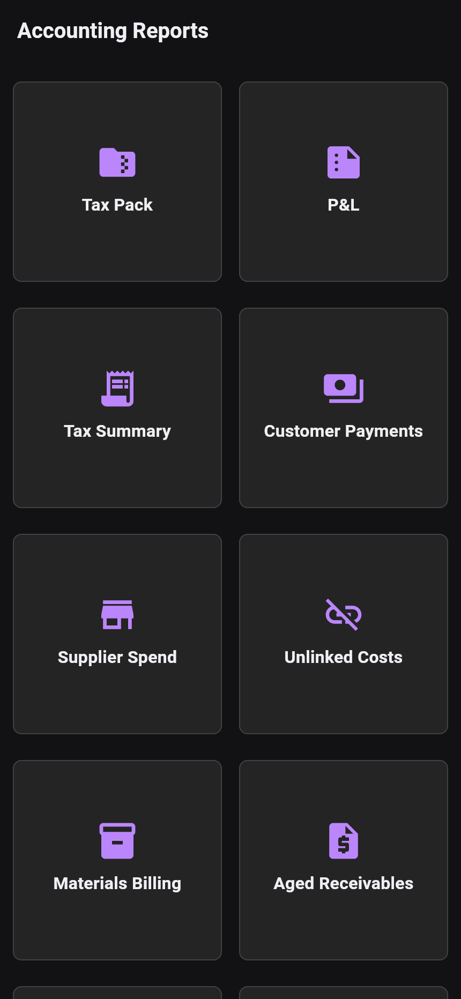

# Accounting

Open **Home → Accounting** for Receipts, Prior work, Estimator, Quotes,
To Be Invoiced, Invoices, Customer Payments, Milestones and Reports.

**To Be Invoiced** includes unbilled work and billing setup needing attention.
A job appearing there does not mean every task is immediately invoiceable.

HMB tracks local customer payments, allocations and invoice balances. Reports
include P&L, Tax Summary, Customer Payments, Supplier Spend, Unlinked Costs,
Materials Billing, Aged Receivables, Statements, Job Profit and Tax Pack.
Review the report period and underlying records before exporting.

Xero integration can upload invoices and refresh external payment status using
Sync. QuickBooks Online export is labelled **preview** in the app.
See [Invoicing](accounting/invoicing.md) and
[Integrations](accounting/invoicing/integration.md).

*Actual Flutter widget render from main 51a4d8e6 (0.42.0), first viewport;
additional report tiles require scrolling. Not an installed Android capture.*
