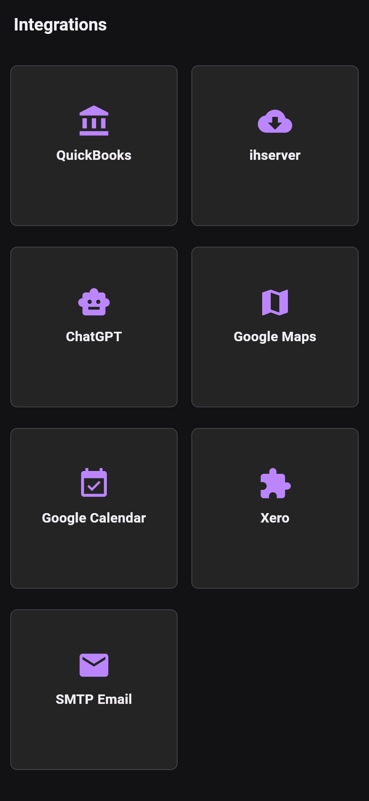

# Settings

Open **Home → Settings**. Configuration is divided into separate pages:

- **Business**: business identity, country, units, web/terms links and hours.
- **Contact**: your business contact information.
- **Billing**: defaults, payment details and quote/invoice appearance.
- **Storage**: photo cache limit and usage.
- **SMS Templates**: reusable message templates.
- **Integrations**: external service configuration.
- **Plasterboard**: layout scoring settings.
- **Setup Wizard**: revisit initial setup.

Under Integrations, the app exposes Xero, QuickBooks (preview), SMTP Email,
Google Calendar, Google Maps, ChatGPT and ihserver booking requests. Enable and
configure only the services you need. These features may send data to the selected
service and need connectivity.

*Actual Flutter widget render from HMB main 51a4d8e6, version 0.42.0; no accounts
connected. This is a widget-test capture, not an installed Android screenshot.*

Integration credentials use the platform secure-storage backend. The older
instruction that they live unencrypted in the system table is obsolete. Do not
assume a restored database also restores device-held integration credentials;
check configuration and authentication after restoring.

See [Logos](system/logos.md) and [Backups](backups.md).
