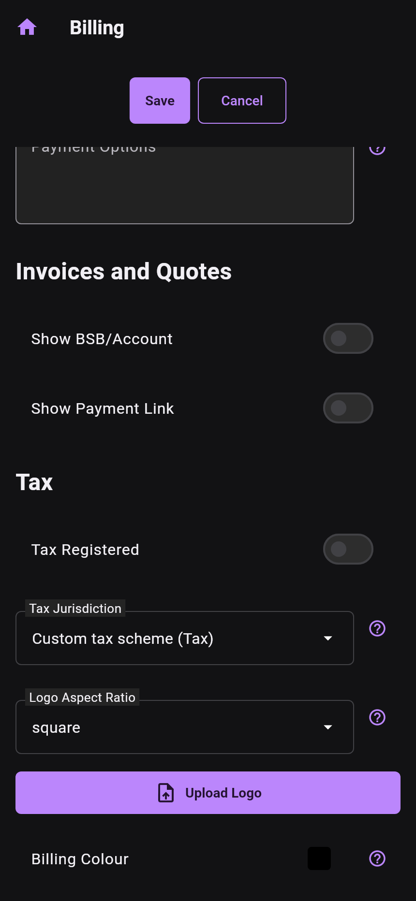
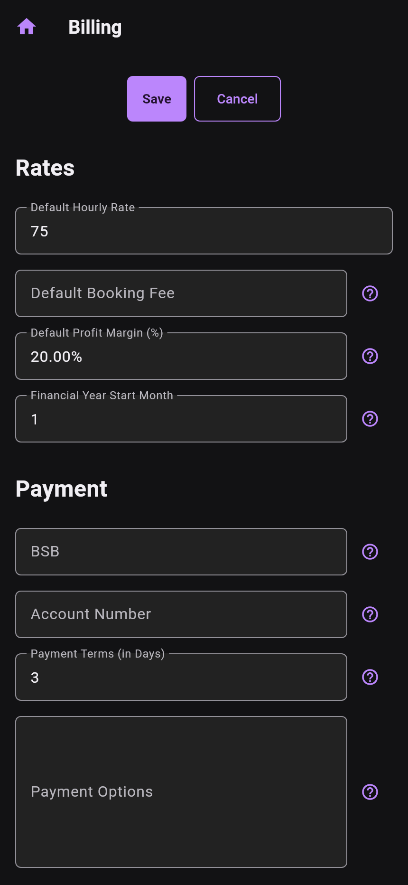

# Logos and PDF appearance

Open **Home → Settings → Billing** and scroll to the quote/invoice appearance
controls. Choose **Logo Aspect Ratio**, then **Upload Logo** to select an image
from the platform gallery. Review the displayed image and **Billing Colour**.

The aspect choices define the display box: square (100 × 100), portrait
(80 × 120), or landscape (120 × 80). They are layout dimensions, not proof that an
input image must have exactly that many pixels. The current picker is an image
gallery picker; the previous manual's “PNG only” claim is not enforced by this
screen's source.

The **Save** and **Cancel** actions remain above the scrolling form. Save the
configuration, then preview a quote or invoice to check the resulting PDF.

*Actual production Billing screen and HomeScaffold renders from main 51a4d8e6 /
0.42.0. Settings are sanitized sample data, bank fields are blank and no logo is
loaded. The first image is a scrolled viewport. These widget-test captures show
the controls; they do not claim an installed-device gallery selection or verified
PDF logo upload.*
