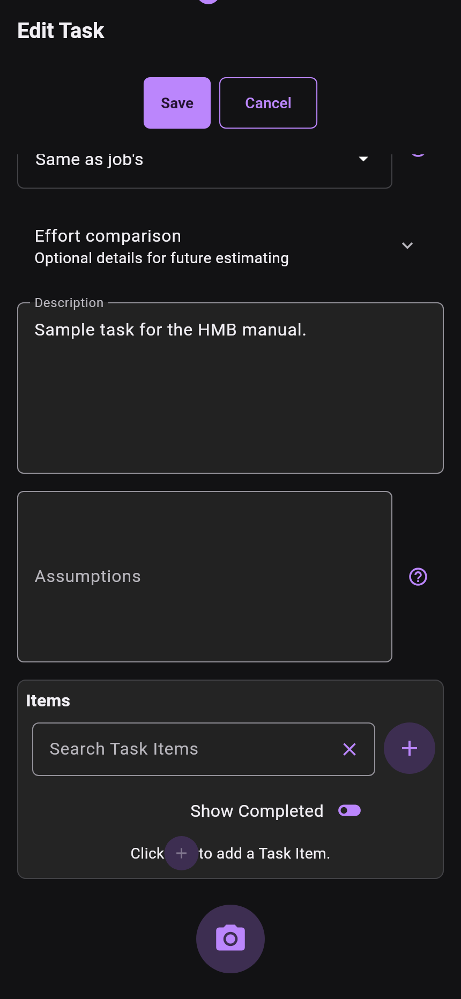

# Photos

Use task photos to record site conditions, measurements and progress. Open a task
and scroll to the camera control below its items. Tap it to choose/capture an
image through the platform picker. You can add comments to saved photos.

The task editor supports pending photos while creating a new task. Save the task
to retain those pending photos with it; cancelling an unsaved edit is not a saved
photo record. The old instruction to always save before the camera appears no
longer describes this editor.

*Actual HMB TaskEditScreen widget render, main 51a4d8e6 / 0.42.0, with a disposable
sample task. This is a scrolled viewport and contains no captured customer photo.
It is not an installed-app or native-camera screenshot.*

Tap a gallery thumbnail to open the photo carousel. Use its magnifying-glass
zoom control for the full-screen viewer, then pan or pinch to inspect details.
The old “X” description is ambiguous: use the zoom control, not a close button.

If a photo is not available locally, the gallery can offer a fetch action. Photo
availability depends on local cache/storage and any completed Drive photo sync.
See [Backups](../backups.md) for the distinction between database backup and
photo sync. A saved database alone does not prove every photo is available.
