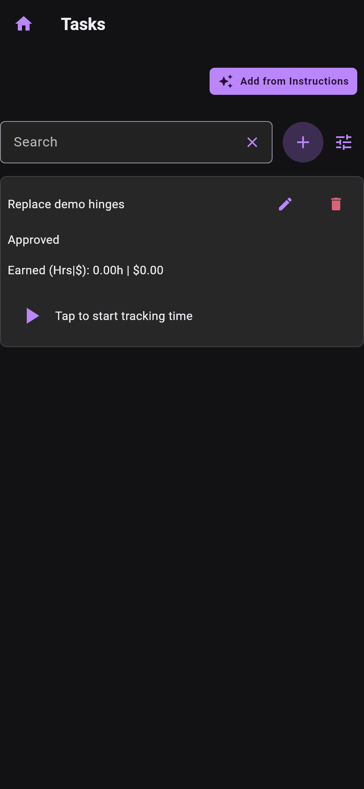
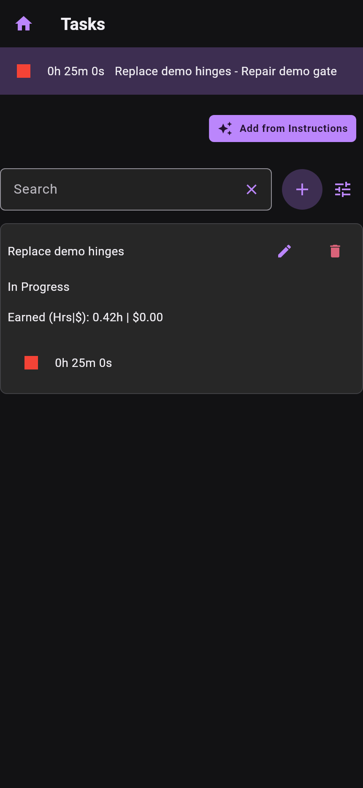
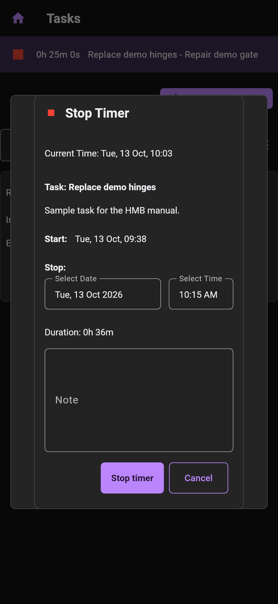

# Time Tracking

Time is recorded against a task. For Time and Materials it supplies billable
labour; for fixed-price tasks it also helps compare estimates with actual effort.

Open the job's tasks. The play control has the tooltip **Start task timer**.

When a task has a running timer, its elapsed time and red stop control appear on
the card. The active-timer bar also identifies the task and job at the top of the
app. HMB supports one active task timer at a time.

Tap a stop control to review the proposed stop time, duration and optional note.
The **Cancel** action appears first, before **Stop timer**, including when
actions wrap on a narrow screen. Cancel leaves the timer running. Check those
values before pressing **Stop timer**. The proposed time can be
rounded; do not assume it is identical to the moment you tapped. The dialog
rejects a stop time before the start and may request confirmation for long entries.

Starting another task while one is running invokes the prior timer's stop flow.
Review that entry before continuing. Task time entries can also be created or
edited manually where corrections are needed; review billed history before
changing an entry already associated with an invoice.

*All three images render production HMB widgets and HomeScaffold from
main 51a4d8e6 / 0.42.0 using a disposable sample job. The running entry is seeded
for capture, and the stop dialog is opened through the real stop control. These
are widget-test captures, not installed-app screenshots or a test of platform
background-timer behavior. The stop-dialog image predates the Cancel-first
layout described above.*
